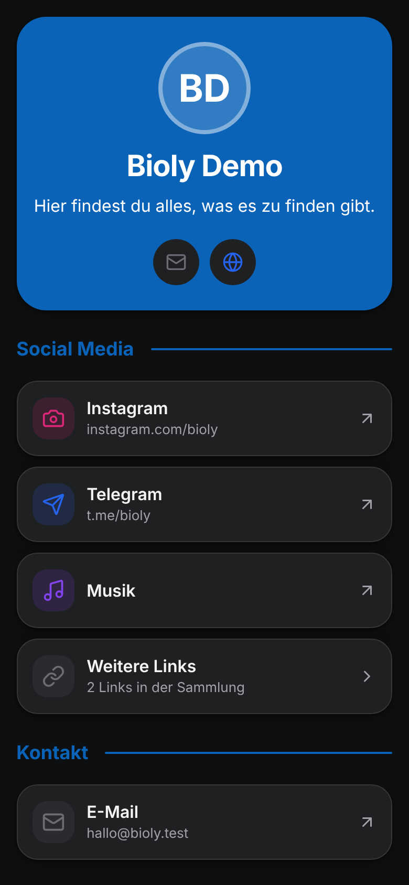
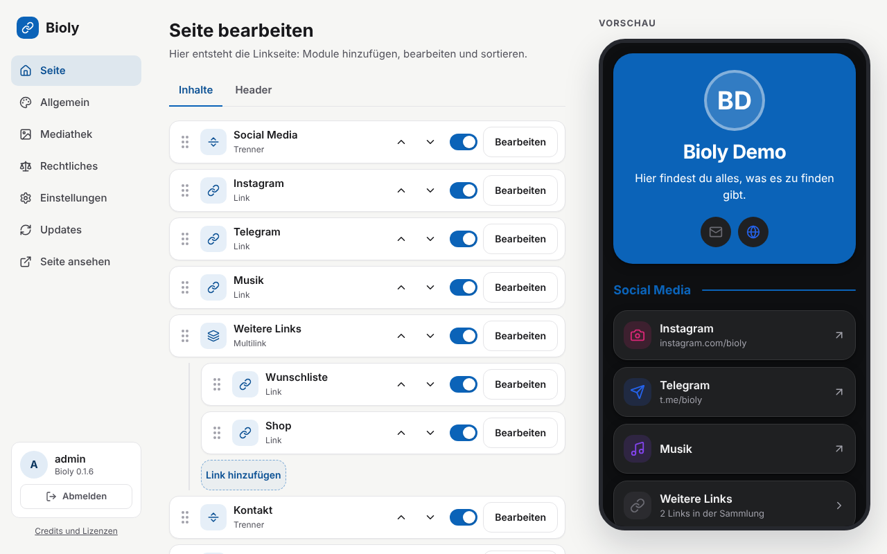

# Bioly

**Your own link page, on your own web space.** Like Linktree, but self-hosted: no account, no tracking, no monthly fee. Upload the zip, point your webroot to `/public`, open your domain, done.

  
  &nbsp;&nbsp;
  

  <a href="https://github.com/bioly-app/bioly/releases/latest"><b>Download</b></a> ·
  <a href="docs/README.md">Documentation</a> ·
  <a href="CHANGELOG.md">Changelog</a> ·
  <a href="https://github.com/bioly-app/bioly/issues">Bugs and ideas</a>

> Status: 0.x. Bioly works and updates itself, but is still young. Feedback is very welcome.

## Features

- **Modules:** links, multilinks (folded link lists), images and sliders, countdown to your next event, dividers
- **Header:** picture, name, bio and up to five quicklinks
- **Design without code:** colors with contrast check, patterns, background image, icon style, corners, favicon, dark and light
- **150 icons and 57 platform logos**, plus your own SVG icons
- **Draft and live preview:** nothing is online until you click "Publish"
- **Media library** with alt texts and a check where each file is used
- **Privacy first:** no cookies on the link page, no external fonts or scripts, a ready text for your privacy policy
- **Secure:** modern login rules, strict Content Security Policy, signed updates
- **Updates and backups in the backend:** one-click updates with automatic backup and rollback; own backups to download and move your page to another installation
- **Imprint and privacy pages** (own text or link), link previews for messengers (Open Graph)
- Backend in **German and English**

## Installation

You need web space with PHP. Most shared hosting packages work.

1. [Download the latest release](https://github.com/bioly-app/bioly/releases/latest) (`bioly-X.Y.Z.zip`) and unpack it
2. Upload the folder by FTP and point your domain to its `public/` folder
3. Open your domain: the installer checks the server, creates your account and optionally sets up email

**Requirements:** PHP 8.3 or newer with `pdo_sqlite`, `mbstring`, `sodium`, `fileinfo` (recommended: `gd`, `zip`, `intl`), SQLite 3.37 or newer, Apache with `mod_rewrite` (Nginx works with your own config), `data/` writable for PHP.

**Updates:** Bioly checks once a day for a new version and installs it from the backend (Updates), with a backup first. Without the updater, copy the new files over the old ones by FTP; `data/` stays untouched.

## Development

You need Docker and `make`. `make` lists all commands; the full workflow is in [docs/10-arbeitsablauf.md](docs/10-arbeitsablauf.md) (German).

| Step | Commands |
| --- | --- |
| Develop | `docker compose up --build`: site http://localhost:8080, backend `/admin` (user `admin`, password `Bioly-Demo-2026`), mail http://localhost:8025. `make reset-demo`, `make reset-empty`, `make migrate` |
| Check before every commit | `make check` (code style, PHPStan, tests, icons, `composer audit`), `make fix` corrects the code style |
| Try an update | `make zip` builds an unsigned test zip, `make testsite` puts it into a separate test site on http://localhost:8081 |
| Release (maintainers) | `make release`, then `make publish` |

The developer documentation (German) explains the [architecture](docs/01-aufbau.md), [how to build a module](docs/03-module.md), [icons](docs/04-icons.md), [design](docs/06-design.md) and [security](docs/09-sicherheit.md).

## Contributing

Bug reports, ideas and pull requests are welcome. Please read [CONTRIBUTING.md](CONTRIBUTING.md) first. Security problems: please report them privately, see [SECURITY.md](SECURITY.md).

## License

Bioly is open source software under the [GNU General Public License v3.0 or later](LICENSE).
Copyright (C) 2026 Benedikt Jany. Third-party parts: see [THIRD-PARTY-NOTICES.md](THIRD-PARTY-NOTICES.md).
