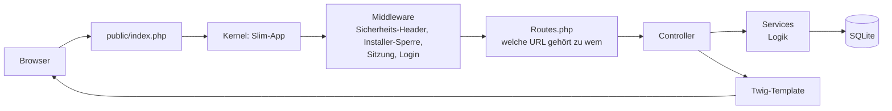

# 1. Das große Bild

## Zwei Welten

Bioly hat zwei Seiten, die sehr unterschiedlich arbeiten:

| | Öffentliche Seite | Backend (`/admin`) |
| --- | --- | --- |
| Wer | Besucher | du als Admin |
| Wie | fertiges HTML aus dem Cache | wird bei jedem Aufruf neu gebaut |
| Ziel | so schnell wie möglich | bequem bearbeiten |

Die öffentliche Seite wird also **nicht** bei jedem Besuch neu zusammengesetzt. Beim Veröffentlichen schreibt Bioly fertige Dateien in `data/cache/`, die dann nur noch ausgeliefert werden.

## Der Weg einer Anfrage



- **Middleware** läuft vor jedem Controller: setzt Sicherheits-Header, schickt vor der Installation zum Installer, startet die Sitzung und prüft beim Backend den Login.
- **Controller** sind dünn: Eingaben lesen, Service aufrufen, Antwort zurückgeben.
- **Services** enthalten die eigentliche Logik (z. B. `MediaService`, `Publisher`).
- **Repositories** sind die einzige Stelle, die SQL schreibt.

## Wo liegt was?

```text
bioly/
├── public/            Webroot: index.php, CSS, JavaScript, Muster
├── src/
│   ├── Http/          Routen, Middleware, Controller
│   ├── Modules/       die Module (Link, Multilink, Bild, Trenner, ...)
│   ├── Module/        Grundgerüst für Module (Registry, Prüfung)
│   ├── Page/          Seite bauen und veröffentlichen
│   ├── Service/       Logik: Login, Mail, Mediathek, Favicon, ...
│   ├── Repository/    Datenbankzugriff
│   ├── Theme/         Farben und Design
│   ├── Icon/          Icon-Bibliothek
│   └── Services.php   der zentrale Werkzeugkasten (siehe unten)
├── templates/         Twig-Vorlagen für Backend und Seite
├── lang/              Übersetzungen (de, en)
├── resources/         Icons, Logos, Interface-Icons
├── migrations/        Änderungen an der Datenbank
├── data/              alles, was entsteht: Datenbank, Uploads, Cache, Logs
└── docs/              diese Doku (nicht im Release)
```

**Merksatz:** Alles in `data/` gehört dem Nutzer und überlebt Updates. Alles andere ist Programm und wird bei einem Update ersetzt.

## Der Werkzeugkasten: `Services.php`

Statt überall Objekte selbst zu bauen, holt sich jeder Teil seine Werkzeuge aus `Services`:

```php
$this->services->media()->storeImage($upload);
$this->services->publisher()->publish();
```

Jedes Werkzeug wird erst gebaut, wenn es zum ersten Mal gebraucht wird, und danach wiederverwendet. Ein neuer Service bekommt dort eine eigene kleine Methode.
