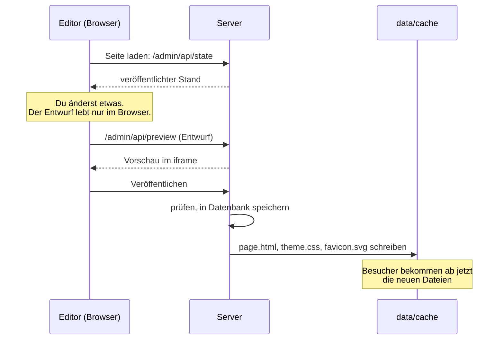

# 2. Vom Entwurf zur Seite

## Der Ablauf

## Wichtig zu wissen

- **Der Entwurf liegt im Browser.** Neu laden oder Tab schließen verwirft ihn; der Browser fragt vorher nach.
- **Die Vorschau** speichert den Entwurf kurz in der Sitzung und rendert ihn mit demselben Code wie die echte Seite. In der Vorschau öffnen Links nichts, Popups schon.
- **Veröffentlichen** prüft alles noch einmal auf dem Server. Der Browser ist nie die einzige Kontrolle.
- **Wie ein Entwurf** funktionieren auch Impressum und Datenschutz: Leiste „Ungespeicherte Änderungen“, „Verwerfen“, „Veröffentlichen“. Der Entwurf liegt dort im Textfeld des Browsers (`legal-editor.js`).
- **Externer Link statt Text:** Pro Seite (Impressum, Datenschutz) wählt man „Eigener Text“ oder „Externe Seite“. Die Adresse steht in `profile.legal`; der Footer verlinkt dann direkt dorthin, `/impressum` bzw. `/datenschutz` leiten weiter. Der eigene Text bleibt gespeichert.
- **Dateien mit Version:** `asset()` hängt `?v=<Version>.<Hash vom Dateidatum>` an CSS und JS. Nachgeladene Module (`multilink.js`, `slider.js`) bekommen ihre Adresse über `data-script-*` am `<body>`. CSS darf ein Jahr im Cache bleiben. JavaScript fragt der Browser jedes Mal kurz nach (`.htaccess`), weil Module sich gegenseitig ohne Version importieren (`./backend/api.js`).
- **Nach einem Update** bringt die erste Anfrage alles auf Stand (`Update/AfterUpdate.php`): Migrationen, alte Daten nachtragen, SVGs neu bereinigen, Seite neu veröffentlichen. Merker ist `data/cache/version`. Das läuft ohne Kommandozeile, also auch beim ZIP-Update auf Webspace. Kommt das Update aus dem Backend und schlägt dieser Schritt fehl, spielt `RunAfterUpdate` das Backup zurück (siehe [Arbeitsablauf](10-arbeitsablauf.md#so-kommt-ein-update-zu-den-nutzern)).
- **Sofort gespeichert** (ohne Veröffentlichen) werden nur Einstellungen und Mediathek. Die Mediathek baut die Seite danach selbst neu, weil Alt-Texte und Farben sichtbar sind.

## Welche Teile sind beteiligt?

| Teil | Aufgabe |
| --- | --- |
| `public/assets/js/editor.js` | der ganze Editor: Liste, Seitenleiste, Icon-Auswahl, Vorschau |
| `public/assets/js/backend/` | geteilte Bausteine: `api.js` (Anfragen mit CSRF), `dom.js` (Elemente bauen), `unsaved.js` (Leiste „Ungespeichert“) |
| `EditorController` | Zustand liefern, Entwurf annehmen, veröffentlichen |
| `Page/Draft.php` | Entwurf bereinigen (`sanitize`) und vor dem Veröffentlichen prüfen (`validate`) |
| `PageBuilder` | macht aus Blöcken die Daten fürs Template |
| `Publisher` | rendert die Seite, Impressum und Datenschutz und schreibt sie in den Cache |
| `templates/frontend/page.twig` | das Gerüst der öffentlichen Seite |

## Multilinks sind die Ausnahme

Die Links in einem Multilink stehen **nicht** im Cache-HTML. Sie werden erst beim Antippen über `/api/multilink/<id>` geladen, und nur außerhalb von In-App-Browsern. Wer daran arbeitet, muss diese Regel erhalten.

Mit **Altersabfrage** fragt die Seite vor dem Laden nach dem Geburtsdatum. Das Datum bleibt im Browser; der Server gibt die Links nur mit dem Header `X-Bioly-Age-Confirmed: 18` heraus (`MultilinkModule::passesAgeGate()`). In-App-Browser bekommen weiterhin nur den Hinweis, noch vor der Altersabfrage. Die Liste der Apps steht nur in `InAppBrowser::PATTERN`; die Seite bekommt sie als `data-in-app`.

## Antworten der API

Fehler sehen überall gleich aus: `{"error": "<code>", ...}` mit passendem HTTP-Status (`Controller::jsonError()`). Bekannte Codes: `in_app`, `age_required` (mit `min_age`), `upload` (mit `message`), `invalid` (mit `fields`), `logged_out`. Skripte reagieren nur auf Codes, die sie kennen, und zeigen sonst eine neutrale Fehlermeldung.
