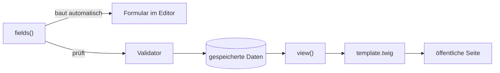

# 3. Module

Module sind die Bausteine einer Seite: Link, Multilink, Bild / Slider, Countdown, Trenner. Bioly findet sie **von selbst**: Jeder Ordner in `src/Modules/` ist ein Modul.

## So ist ein Modul aufgebaut

```text
src/Modules/Notice/
├── NoticeModule.php    Felder, Daten fürs Template
├── template.twig       wie es auf der Seite aussieht
├── icon.svg            Icon in der Modulliste
├── ICON-LICENSE.txt    Lizenz des Icons
└── lang/
    ├── de.json         Texte auf Deutsch
    └── en.json         Texte auf Englisch
```



Das Wichtigste: **Du schreibst kein JavaScript.** Das Formular im Editor entsteht aus `fields()`.

## Anleitung: ein neues Modul „Hinweis“

**1. Klasse anlegen** `src/Modules/Notice/NoticeModule.php`

```php
namespace Bioly\Modules\Notice;

use Bioly\Module\AbstractModule;
use Bioly\Module\RenderContext;

final class NoticeModule extends AbstractModule
{
    public function type(): string
    {
        return 'notice';
    }

    public function fields(): array
    {
        return [
            ['name' => 'text', 'type' => 'textarea', 'required' => true, 'max' => 300, 'group' => 'text'],
            ['name' => 'tone', 'type' => 'select', 'options' => ['info', 'warn'], 'default' => 'info', 'group' => 'look'],
        ];
    }

    public function view(array $data, array $children, RenderContext $context): array
    {
        return ['text' => $data['text'], 'tone' => $data['tone'] ?: 'info'];
    }
}
```

**2. Template** `template.twig`

```twig
<p class="notice notice--{{ tone }}">{{ text }}</p>
```

Twig maskiert alles automatisch. Kein `|raw` für Nutzereingaben.

**3. Texte** `lang/de.json`

```json
{
  "module.notice.name": "Hinweis",
  "module.notice.description": "Ein kurzer Text in einem Kasten",
  "module.notice.text": "Text",
  "module.notice.tone": "Farbe",
  "module.notice.tone.info": "Info",
  "module.notice.tone.warn": "Warnung"
}
```

**4. Icon** von [Lucide](https://lucide.dev) als `icon.svg` ablegen, Lizenz als `ICON-LICENSE.txt` daneben (Vorlage: `src/Modules/Link/ICON-LICENSE.txt`).

**5. Styles** für die Seite in `public/assets/css/site.css` ergänzen.

Fertig. Nach dem Neuladen steht „Hinweis“ in „Modul hinzufügen“.

## Feldtypen

| Typ | Im Editor | Prüfung |
| --- | --- | --- |
| `text` | einzeiliges Feld | `required`, `max` |
| `textarea` | mehrzeilig | `required`, `max` |
| `url` | Feld für Adressen | nur http, https, mailto, tel |
| `icon` | Icon-Auswahl | Icon muss existieren |
| `select` | Auswahlliste | nur Werte aus `options` |
| `toggle` | Checkbox | wird zu ja / nein |
| `images` | Bilder aus der Mediathek | 1 bis 12 Bilder |
| `date` | Datumsauswahl des Browsers | gültiges Datum (JJJJ-MM-TT) |
| `time` | Uhrzeitauswahl des Browsers | gültige Uhrzeit (HH:MM) |

## Weitere Angaben pro Feld

| Angabe | Wirkung |
| --- | --- |
| `pair` | `true`: Das Feld steht neben dem Feld davor, z. B. Uhrzeit neben Datum. Ist zu wenig Platz, rutscht es darunter. |
| `group` | Felder mit gleicher Gruppe stehen zusammen. Wo eine neue Gruppe beginnt, zeichnet der Editor eine Linie mit Überschrift (`editor.group.<name>` in `lang/`). |
| `default` | Startwert für neue Blöcke |
| `help` | kein Schlüssel nötig: Text unter `module.<typ>.<feld>.help` erscheint automatisch |

Vorhandene Gruppen: `text`, `time`, `target`, `icon`, `images`, `look`, `autoplay`, `a11y`.

## Weitere Stellschrauben

| Methode | Wofür |
| --- | --- |
| `isTile()` | `true`: steht wie ein Link im Kachel-Raster |
| `acceptsChildren()` | `true`: kann Links enthalten (wie der Multilink) |
| `sortOrder()` | Platz in „Modul hinzufügen“: Standard 50, Bild 60, Trenner 90 |

## Datum und Uhrzeit

`$context->zone()` ist die Zeitzone aus den Einstellungen, `$context->now()` die aktuelle Zeit darin. Tests geben über `RenderContext` eine feste Zeit vor.

Die Seite ist eine fertige Datei, die nur beim Veröffentlichen entsteht. Was sich mit der Zeit ändert, muss deshalb ein kleines Script im Browser nachziehen. Beispiel: Der Countdown (`src/Modules/Countdown/`) schreibt Beginn und Ende als ISO-Zeit mit Zeitzone in `data-start` und `data-end`. `public/assets/js/countdown.js` zählt damit herunter und schaltet zwischen „vorher“, „läuft“ und „vorbei“ um. `site.js` lädt das Script nur, wenn die Seite einen Countdown hat.

## Daten aus der Mediathek

`$context->media($dateiname)` liefert die Zeile aus der Mediathek: Alt-Text, Durchschnittsfarbe, Transparenz. So macht es das Bild-Modul.
