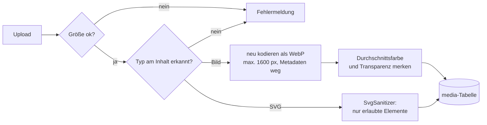

# 5. Mediathek

## Was mit einem Upload passiert

- **Bilder** werden immer neu kodiert. Dabei verschwinden GPS-Daten, Kameradaten und alles, was im Original versteckt sein könnte.
- **SVGs** werden nicht nur geprüft, sondern **neu aufgebaut**: Nur Formen, Pfade und Farben aus einer Erlaubnisliste kommen durch. Skripte, Links und externe Verweise fallen weg.
- **Dateinamen** vergibt Bioly selbst, zufällig: `image-<16 Zeichen>.webp`. Der Originalname wird nur als Bezeichnung angeboten.

## Ausgeliefert unter `/media/<name>`

Nur Namen nach festem Muster werden ausgeliefert, mit eigener strenger Sicherheitsrichtlinie. So kann eine Datei nie als Webseite oder Skript ausgeführt werden.

## Verwendung und Löschen

`MediaUsage` prüft, wo eine Datei verwendet wird: Header, Bild-Module, Icons in Links, Favicon (als Icon oder als eigene SVG). Verwendete Dateien lassen sich nicht löschen. Ein neues Modul, das Mediathek-Dateien nutzt, muss dort ergänzt werden.

## Transparenz und Durchschnittsfarbe

| Bild | Hintergrund auf der Seite | Zuschnitt |
| --- | --- | --- |
| Foto | Durchschnittsfarbe, solange es lädt | füllt den Rahmen (`cover`) |
| transparent (Logo) | keiner, die Seite scheint durch | ganz sichtbar (`contain`) |

Im Backend liegt hinter transparenten Bildern ein Schachbrettmuster.

## Alt-Text: der Ort entscheidet

Ein Bild hat in der Mediathek genau einen Alt-Text. Ob er ausgegeben wird, entscheidet die Vorlage, die das Bild einbaut, nicht der Nutzer:

| Ort | Alt-Text |
| --- | --- |
| Profilbild im Header, Bild-Modul (Slider) | immer der Alt-Text aus der Mediathek |
| reine Deko, z. B. ein Hintergrundbild | immer leer (`alt=""` oder CSS-Hintergrund) |
| Vorschaubilder im Backend | leer, der Name steht daneben |

Wer ein Bild neu einbaut, legt in der Vorlage fest, welcher Fall gilt. Fehlt ein nötiger Alt-Text, zeigt das Backend den Hinweis „Noch kein Alt-Text“.
