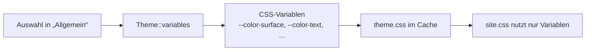

# 6. Design

## Aus wenigen Werten wird ein ganzes Theme

Der Nutzer wählt nur wenige Dinge: Hauptfarbe, Hintergrund, Header-Farbe, Icon-Stil, Rundung. Alles andere rechnet `Theme.php` aus.

| Variable | Woher |
| --- | --- |
| `--color-bg` | Hintergrundfarbe, beim Hintergrundbild dessen Grundfarbe (`image_tone`) |
| `--color-surface` | Kartenfarbe, aus dem Hintergrund abgeleitet |
| `--color-text` | hell oder dunkel, je nach Hintergrund |
| `--color-heading` | Überschriften und Trenner, Kontrast wird geprüft |
| `--color-on-bg` | schwarz oder weiß direkt auf dem Hintergrund (Footer) |
| `--icon-<farbe>` | jede Icon-Farbe, an den Hintergrund angepasst |

## Regeln für neue Styles

- In `site.css` **nie feste Farben** für Inhalte verwenden, immer die Variablen. Dann passt alles zu jedem Theme.
- **Kontrast** prüft Bioly beim Ableiten. Wer eine neue Farbe braucht, ergänzt sie in `Theme::variables()` mit `Color::ensureContrast()`.
- **Abstände und Größen** mit `clamp()` statt festen Werten, damit Handy und Desktop passen.
- **Breakpoint** für zwei Spalten: 640 px.

## Editor und Seite sehen gleich aus

Die Icon-Vorschau im Editor nutzt dieselben Farben wie die Seite (`Theme::iconLook()`). Wer am Icon-Stil etwas ändert, ändert es an beiden Stellen.

## Muster und Hintergrund

Header und Hintergrund speichern ein Muster in derselben Form: `{id, strength, size, fade}`. `Theme::patternCss()` macht daraus das CSS, der Editor zeichnet beide Auswahlen mit `renderPatternPicker()`.

| Konstante in `Theme.php` | Inhalt |
| --- | --- |
| `PATTERN_STRENGTH` | Deckkraft in Prozent: dezent 8, mittel 18, kräftig 32 |
| `PATTERN_SIZE` | Faktor auf die Kachelgröße: 0,75, 1, 1,5 |
| `PATTERN_FADE` | Verlauf: aus, nach unten oder nach oben auslaufen |

Der Editor bekommt diese Werte als `meta.patternLevels`. Neue Stufen also nur in `Theme.php` ergänzen, plus Sprachschlüssel.

Der Hintergrund hat `type` `color` oder `image`. Beim Bild zeigt `.site__image` das Foto aus der Mediathek, und die Farben richten sich nach `image_tone`. Ohne gültiges Bild fällt `normalize()` auf `color` zurück. Alte Daten (Muster als Name, Typ `pattern`) übersetzt `normalize()` beim Lesen.

## Markenfarbe

Bioly selbst ist **Azur `#0B63B8`** (weißer Text 6:1).

- PHP: `Theme::BRAND`, gleichzeitig die Hauptfarbe einer neuen Seite und die Vorgabe im Installer.
- Backend: `--brand` in `backend/tokens.css`. Alle Blautöne (`--accent-dark`, `--accent-tint`, `--accent-ink`, ...) werden mit `color-mix()` daraus berechnet.
- Ein Test (`ThemeTest::testBrandColorIsTheSameEverywhere`) prüft, dass beide Werte gleich sind.

Im Backend gibt es keine festen Farben außerhalb von `:root`. Status (ok, warn, danger) hat je eine Linie, einen hellen Grund, eine weiche Fläche und eine dunkle Schrift als Variable.

## Backend-CSS

Die Dateien liegen in `public/assets/css/backend/` und werden alle über `templates/layout/backend-styles.twig` eingebunden:

| Datei | Inhalt |
| --- | --- |
| `tokens.css` | alle Variablen: Farben, Schrift, Abstände, Ecken, Höhen, Icon-Größen, Schatten. Legt die Reihenfolge der Ebenen (`@layer`) fest |
| `base.css` | Grundlagen und kleine Helfer |
| `forms.css` | Felder, Passwortfeld, Auswahlkarten, Umschalter |
| `buttons.css` | Buttons |
| `components.css` | Karten, Panels, Hinweise, Tabs, Dialoge, Seitenleiste zum Bearbeiten, Tabellen |
| `layout.css` | Seitenrahmen: Navigation, Hauptbereich, Vorschau |
| `editor.css` | Seiten-Editor: Blockliste, Icon- und Musterauswahl, Bildfelder |
| `pages.css` | Mediathek und Rechtstexte |

- **Ebenen statt Reihenfolge:** Jede Datei ist eine `@layer`. Spätere Ebenen gewinnen, egal wie genau ein Selektor ist. Was überall gewinnen muss (z. B. das Schachbrett hinter transparenten Bildern), steht in der Ebene `states`.
- **Keine festen Werte in Regeln:** Farben stehen nur in `tokens.css`. Ein Test (`CssTest`) schlägt fehl, wenn irgendwo anders eine Farbe steht. Größen und Abstände kommen ebenfalls aus Variablen.
- **Abstände** sind Schritte von 2 px (`--space-4` = 8 px). Wer `--space-unit` ändert, ändert alle Abstände gleichmäßig.
- **Linkseite:** `site.css` bleibt eine einzige Datei, weil jede zusätzliche Anfrage den ersten Aufbau der öffentlichen Seite bremst. Feste Farben stehen auch dort nur in `:root`.

