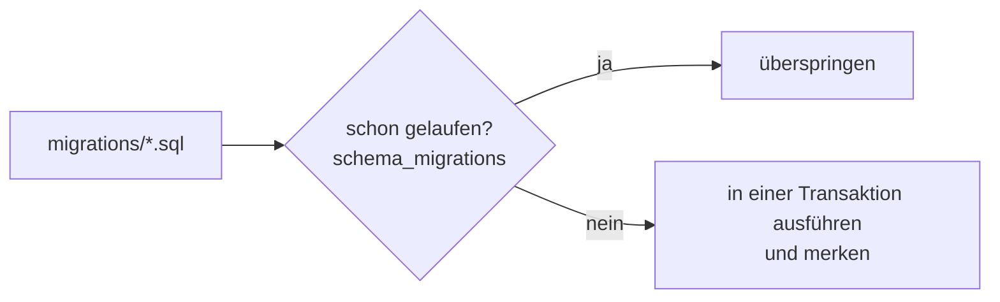

# 8. Datenbank

Bioly nutzt **eine SQLite-Datei**: `data/app.sqlite`. Kein Datenbankserver, keine Zugangsdaten.

## Die Tabellen

| Tabelle | Inhalt |
| --- | --- |
| `users` | der eine Admin |
| `settings` | Schlüssel und JSON-Wert: `site`, `theme`, `smtp`, `publish` |
| `blocks` | alle Module der Seite, Links im Multilink mit `parent_id` |
| `media` | Mediathek: Dateiname, Bezeichnung, Alt-Text, Farbe, Transparenz |
| `pages` | Impressum und Datenschutz |
| `tokens`, `login_attempts` | Reset-Links, Codes, Login-Sperre |

SQL steht **nur** in `src/Repository/`. Controller und Services rufen Methoden wie `$repository->find($id)` auf.

## Anleitung: Datenbank ändern (Migration)

1. Neue Datei in `migrations/`, fortlaufend nummeriert: `0005_beschreibung.sql`
2. Darin das SQL, z. B. `ALTER TABLE media ADD COLUMN ...;`
3. `make migrate` (oder Container neu starten)

## Regeln für Migrationen

- **Eine veröffentlichte Migration nie mehr ändern.** Fehler werden mit einer neuen Migration korrigiert (Beispiel: `0004` korrigiert die Daten von `0003`).
- Spalten **hinzufügen** ist sicher. Umbenennen oder Löschen in mehreren Schritten über mehrere Versionen.
- Nur SQL, das SQLite 3.37 kann.
- Migrationen laufen beim Installer, beim Start des Containers, mit `make migrate`, beim ersten Aufruf nach einem Update (`AfterUpdate`) und beim Wiederherstellen eines älteren eigenen Backups.
