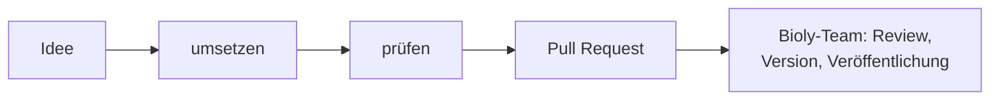
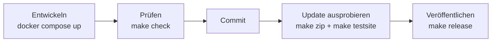

# 10. Arbeitsablauf

## Von der Idee zur Version

## Make-Befehle

Alles läuft über `make` im Projektordner. `make` allein zeigt alle Befehle mit kurzer Erklärung. Die Befehle sind nach den vier Schritten des Ablaufs sortiert:

### 1. Entwickeln

| Befehl | Was passiert |
| --- | --- |
| `docker compose up --build` | startet Bioly (kein Make-Befehl, Docker direkt): Seite http://localhost:8080, Backend `/admin`, Mails http://localhost:8025. Beim ersten Start gibt es Demodaten, danach laufen neue Migrationen automatisch |
| `make reset-demo` | löscht alle Daten und legt die Demodaten neu an |
| `make reset-empty` | löscht alle Daten, beim nächsten Aufruf startet der Installer |
| `make migrate` | spielt neue Migrationen ein, ohne den Container neu zu starten |

### 2. Prüfen (vor jedem Commit)

| Befehl | Was passiert |
| --- | --- |
| `make check` | **alles auf einmal**: Code-Stil, PHPStan, Tests, Icons und `composer audit` (bekannte Sicherheitslücken in den Abhängigkeiten) |
| `make fix` | Code-Stil automatisch korrigieren, wenn `make check` Stilfehler meldet (ändert Dateien) |
| `make check-icons` | nur die Icon-Ordner prüfen, z. B. nach dem Hinzufügen eines Icons |

Eine Prüf-Action auf Forgejo gibt es bewusst nicht: Geprüft wird lokal mit `make check`. Der Container läuft mit der neuesten PHP-Version; PHPStan prüft trotzdem gegen PHP 8.3 (`phpVersion` in `phpstan.neon`), die älteste unterstützte Version. Einzelne Prüfungen gehen bei Bedarf direkt: `docker compose exec app composer test` (oder `analyse`, `lint`).

### 3. Ein Update ausprobieren

| Befehl | Was passiert |
| --- | --- |
| `make zip` | baut eine Test-ZIP in `dist/`, genau so wie ein echtes Release, nur **ohne Signatur**. `VERSION` und Changelog bleiben unverändert. Die ZIP heißt z. B. `bioly-0.1.6-dev.202611212330.zip`: nächste Patch-Version plus `dev` und Zeitstempel. Damit zählt sie als neuer als die installierte Version, aber älter als das echte 0.1.6 |
| `make testsite` | spielt die neueste ZIP aus `dist/` (oder `ZIP=dist/…`) in eine **eigene Testseite** auf http://localhost:8081 ein, so wie ein Nutzer sie per FTP hochlädt: alle Programmdateien werden überschrieben, `data/` bleibt. Der nächste Aufruf der Testseite führt das Update zu Ende (Migrationen, Seite neu bauen). Bei einer leeren Testseite startet der Installer |
| `make testsite-reset` | leert die Testseite, die nächste ZIP wird wie eine Neuinstallation eingespielt |

Die Testseite sieht deinen Code-Ordner nie, nur den Inhalt der ZIP. Sie verhält sich also wie eine echte Installation. So prüfst du zum Beispiel ein Update von der letzten Version:

1. `make testsite-reset`
2. die ZIP der letzten Version einspielen: `make testsite ZIP=dist/bioly-0.1.5.zip`, im Browser installieren und etwas Inhalt anlegen
3. `make zip`, dann `make testsite`
4. im Browser prüfen, ob alles noch da ist und richtig aussieht

**Update über das Backend testen:** Statt `make testsite` lässt sich die Test-ZIP auch auf der Testseite unter Updates > „Update aus einer Datei“ hochladen. So läuft der echte Weg mit Backup, Prüfung und Zurücksetzen. Test-ZIPs sind nicht signiert; nur die Testseite nimmt sie an (`BIOLY_ALLOW_UNSIGNED_UPDATES` in `docker-compose.yml`). Jede echte Installation lehnt sie ab.

### So kommt ein Update zu den Nutzern

- **Suche:** Das Backend fragt höchstens einmal am Tag bei GitHub nach dem neuesten veröffentlichten Release (`ReleaseFeed`, `UpdateCheck`). Das passiert im Hintergrund, keine Seite wartet darauf. Abschaltbar unter Updates. Entwürfe und Vorabversionen zählen nie als neueste Version.
- **Hinweis:** Gibt es eine neuere Version, steht in der Navigation bei „Updates“ ein „Neu“.
- **Installieren** (`Updater`), per Klick oder mit einer hochgeladenen ZIP:
  1. ZIP herunterladen und auspacken (`Package`): nur Einträge in `bioly/`, Signatur von `manifest.json` mit `PublicKey` prüfen, jede Datei gegen ihre Prüfsumme, keine zusätzlichen Dateien
  2. Backup von Programmdateien und Datenbank in `data/backups/` (`Backups`, die letzten zwei bleiben)
  3. neue Dateien kopieren, Dateien der alten Version löschen, die es nicht mehr gibt; `data/` bleibt unangetastet
  4. der nächste Aufruf führt Migrationen aus und baut die Seite neu (`AfterUpdate`). Schlägt das fehl, kommt das Backup automatisch zurück
- **Eigene Backups** („Backup jetzt erstellen“) enthalten nur den Inhalt: Datenbank und Mediathek, keine Programmdateien (die lassen sich immer neu installieren). Sie bleiben, bis sie gelöscht werden, lassen sich als ZIP herunterladen und wieder hochladen, auch auf einer anderen Installation. Beim Hochladen werden nur `backup.json`, `app.sqlite` und Mediendateien angenommen. Beim Wiederherstellen bleiben Konto, Login-Daten, E-Mail-Einstellungen, Update-Einstellungen und die Adresse der Seite dieser Installation erhalten; ein älteres Backup wird auf den aktuellen Stand gebracht, eines von einer neueren Version abgelehnt
- **Die Datenbank** wird beim Wiederherstellen in SQLite selbst ersetzt (`ATTACH`, Tabellen neu anlegen und kopieren), nicht als Datei getauscht, weil die offene Verbindung mit WAL-Journal sonst kaputtgehen könnte. `data/config.php` mit dem geheimen Schlüssel ist in keinem Backup
- **Gesperrt** ist das Update in der Entwicklungsumgebung (`APP_ENV=dev` oder ein `.git`-Ordner), damit es nie den Quellcode überschreibt, und wenn der Server die Programmdateien nicht ändern darf.
- **Ohne Updater** geht es weiter per FTP: neue Dateien über die alten kopieren, `data/` nicht anfassen.

### 4. Veröffentlichen (nur das Bioly-Team)

| Befehl | Was passiert |
| --- | --- |
| `make keys` | erzeugt das Schlüsselpaar zum Signieren. **Nur ein einziges Mal**, ein zweites Paar würde bestehende Installationen von Updates abschneiden. Fragt deshalb zweimal nach: erst `NEW KEY` eintippen, dann noch einmal mit `y` bestätigen |
| `make release` | fragt nach der neuen Version, baut die **signierte** ZIP in `dist/` und trägt die Version in `VERSION` und im Changelog ein. Danach: prüfen, committen, veröffentlichen |

**Versionsnummern:** Während der Entwicklung bleibt `VERSION` unverändert, alles Neue kommt unter `## [Unreleased]` im Changelog. Nur `make release` setzt die Nummer. Testversionen sind immer die Test-ZIPs aus `make zip`, es gibt keine eigenen Vorabversionen.

**Ablauf einer Veröffentlichung:**

1. `make check` ist grün
2. Update ausprobieren: `make zip`, `make testsite` (siehe Schritt 3)
3. `make release`: Version eingeben, die signierte ZIP liegt in `dist/`
4. Changelog prüfen, `VERSION` und `CHANGELOG.md` committen
5. Tag `vX.Y.Z` setzen und pushen, ZIP und `.sha256` ans Release hängen

**Kommt noch:** `make publish` pusht `main` und den Tag `vX.Y.Z` zu GitHub (`bioly-app/bioly`) und legt dort das Release mit ZIP, Prüfsumme und Changelog an. Erst dann sehen die Installationen das Update. Es gibt keine Actions; alles läuft lokal.

Dazu von Hand:

- Im Browser durchklicken, auf **Handy-, Tablet- und Desktop-Breite**
- Backend auf **Englisch** umstellen: Steht noch irgendwo Deutsch oder ein Schlüssel?
- Mit der **Tastatur** bedienen: Kommt man überall hin, sieht man den Fokus?

## Code-Regeln in Kürze

- **DRY:** Wiederholtes in eine Funktion, ein Makro oder einen Service
- **CSS in BEM:** `block__element--modifier`, z. B. `tile__icon`, `slider__button--prev`
- **Kommentare auf Englisch,** kurz, und sie erklären das Warum
- PHP 8.3 als Mindestversion, `declare(strict_types=1)` in jeder Datei

## Neue Versionen

Beiträge kommen als **Pull Request**. Versionsnummer, Changelog und das Veröffentlichen einer neuen Version übernimmt allein das Bioly-Team. Jede offizielle Version ist signiert; Bioly installiert nur Updates mit gültiger Signatur.

Im Pull Request bitte kurz beschreiben: was sich ändert, warum, und wie man es testet.

## Wo geht was hin?

| Ich will ... | Datei |
| --- | --- |
| eine neue Seite im Backend | Route in `Routes.php`, Controller in `src/Http/Controller/Admin/`, Template in `templates/backend/` |
| etwas auf der öffentlichen Seite ändern | `templates/frontend/page.twig`, `public/assets/css/site.css` |
| Logik ergänzen | Service in `src/Service/`, im Werkzeugkasten `Services.php` eintragen |
| Daten speichern | Migration + Repository |
| einen Text ändern | `lang/de.json` und `lang/en.json` |
